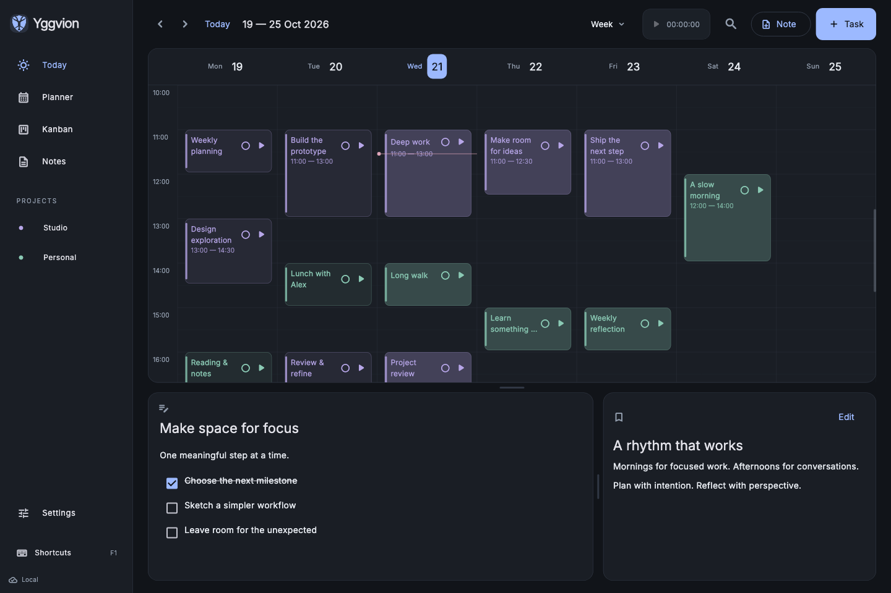
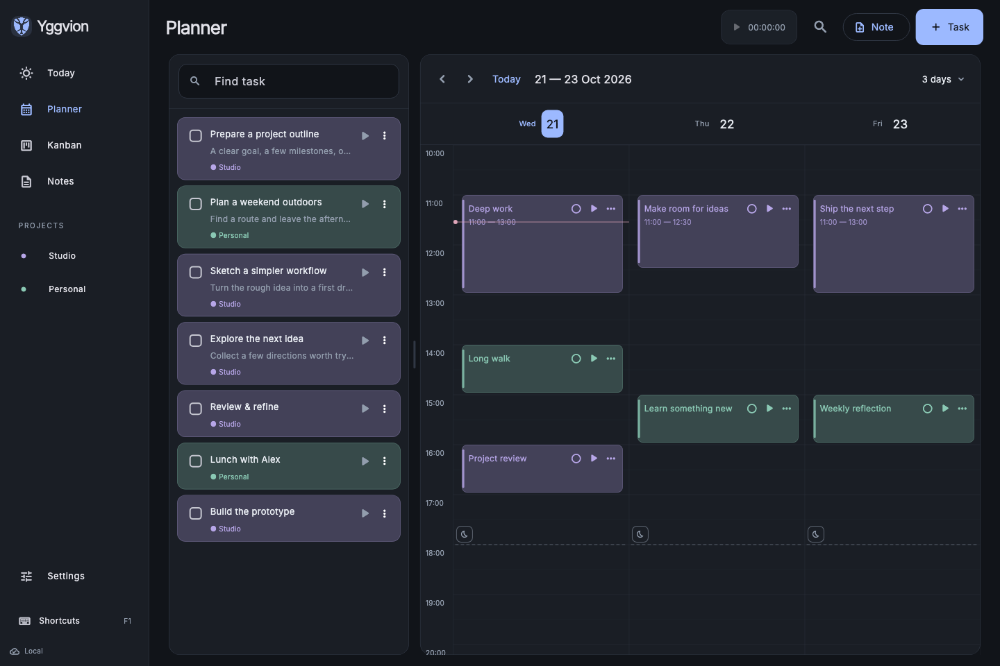
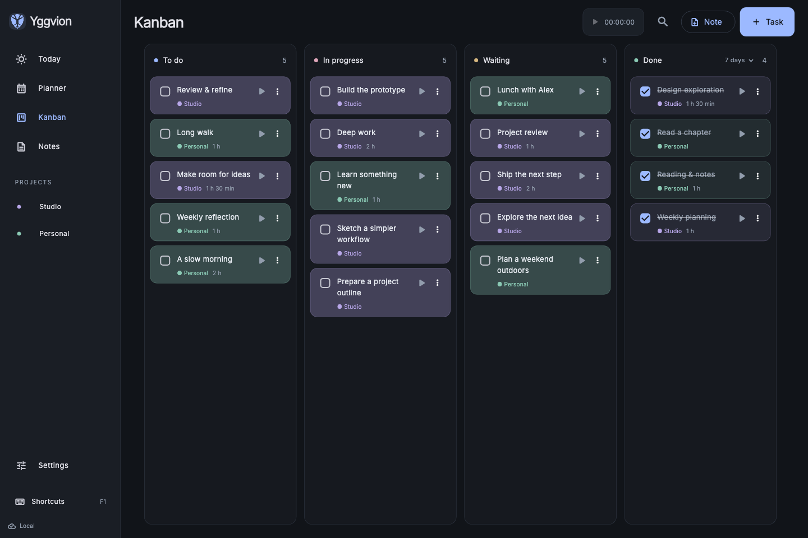
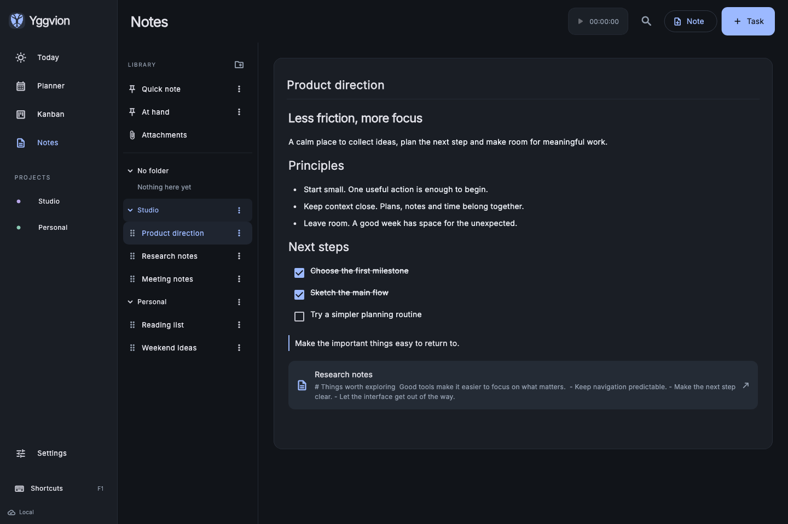
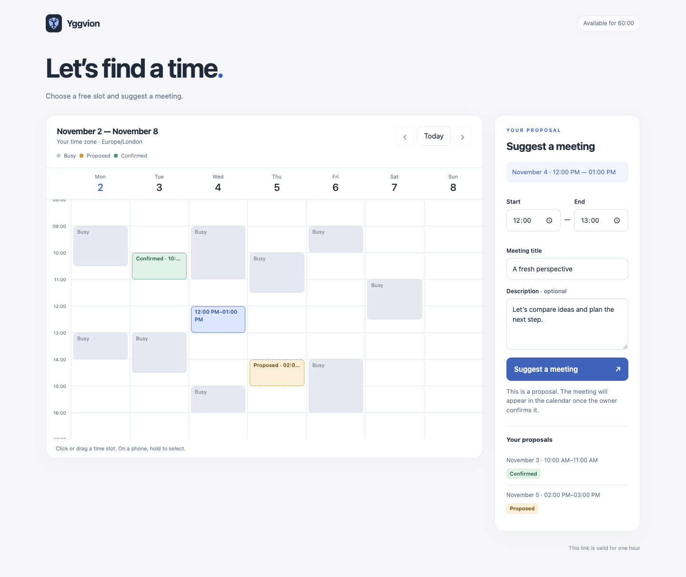

  

# Yggvion

**Your time, plans and ideas — in one place.**

A personal calendar, task planner, Markdown notebook and time tracker. 
Work locally. Sync across your devices with a server you control.

[Explore the features](docs/features.md) · [Build from source](docs/building.md) · [Documentation](docs/README.md)

### Make room for what matters

- **Plan your days.** Shape your schedule in the calendar and move ideas into action with Kanban.
- **Keep your thoughts connected.** Write Markdown notes, link them together and keep files close to your work.
- **Understand your time.** Track what you do, compare it with your estimates and find a working rhythm.
- **Keep control of your data.** Work offline, make local backups and run synchronization on your own VPS.
- **End-to-end encryption (E2EE).** Personal records and attachments are encrypted on your devices before synchronization. Your encryption password stays on your devices. [How it works](docs/architecture.md#encryption).
- **Share your availability.** Send a temporary calendar link and review guests' meeting proposals in Planner.

**Android · iOS · macOS · Windows · Linux** 
Dark and light themes. Six languages. One personal workspace.

### Planner

Pick a task from your list, place it in the calendar and adjust its time and duration. Keep unscheduled ideas and your schedule in view together.

### Kanban

Move tasks through To do, In progress, Waiting and Done. Project colors keep different areas of your work easy to follow.

### Notes

Write Markdown with live preview, organize notes in folders and connect them with `[[wiki links]]`. Keep checklists and attachments alongside your ideas.

### Calendar sharing

Send a link that expires in one hour. Guests see busy intervals without private event titles or descriptions, select a free slot and suggest a meeting. You can accept or reschedule it in Planner; the guest sees its updated status.

[Explore calendar sharing](docs/synchronization.md#calendar-sharing). Screenshots use synthetic demo data.

---

Early development · Version 0.1 · Project license pending selection

[Contribute](CONTRIBUTING.md) · [Security](SECURITY.md) · [Third-party notices](THIRD_PARTY_NOTICES.md)
